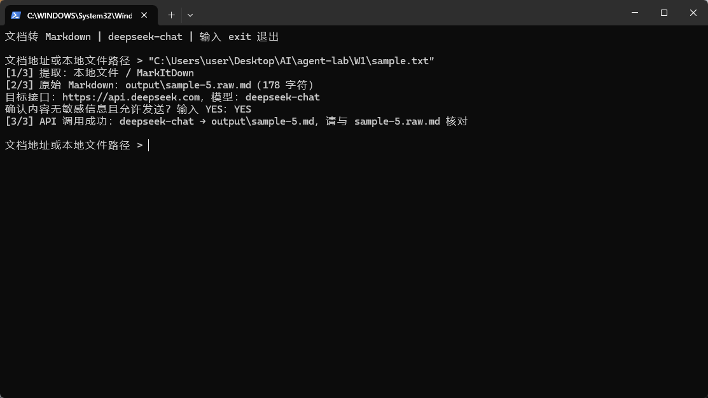

# markdown is all you need

## 一、说明

**把资料交给大模型之前，不应该先花大量时间复制正文、转换格式和整理结构。**

日常工作中，我经常接触内容和格式各异的文档。所以我选择做一个命令行转换工具：输入本地文件路径或飞书文档链接，即可生成 Markdown，并在末尾附上 AI 总结，方便使用者或大模型更快速地获取文档内容。

- **API 调用 LLM**：使用 OpenAI 兼容接口，默认配置公司部署的 `glm-5.2`，整理正文并生成总结。
- **调用工具**：使用 MarkItDown SKILL 提取本地文件，使用 Browser MCP 读取已授权的飞书文档。

## 二、正文

### 实现流程

```text
本地文件 → MarkItDown ──────┐
                           ├→ 原始 Markdown → LLM API → 正文 + AI 总结
飞书链接 → Browser MCP ────┘
```

启动后粘贴地址，确认允许发送给模型，即可转换。输出保存在 `output/`：`.raw.md` 用于核对原文，`.md` 是最终结果；重名自动编号，输入 `exit` 退出。

本地启动（使用者已完成环境与接口配置）：

```powershell
cd C:\Users\user\Desktop\AI\agent-lab\W1
.\.venv\Scripts\python.exe convert.py
```

### 运行展示



**限制：**不支持扫描 PDF 的 OCR；飞书复杂内容及模型结果需人工核对。公司接口使用 HTTP，仅发送获准的非敏感材料。

## 三、代码（关键部分）

### 1. 提取文档内容

```python
kind = validate_source(source)
text = (
    asyncio.run(read_feishu(source))  # 通过 Browser MCP 读取飞书正文
    if kind == "feishu"
    else MarkItDown().convert_local(source).text_content
)
```

### 2. 调用 LLM API

以下为核心调用逻辑摘录；密钥由使用者自行配置。

```python
BASE_URL = os.environ.get("LLM_BASE_URL", "http://221.131.102.69:18088/v1")
MODEL = os.environ.get("LLM_MODEL", "glm-5.2")

with OpenAI(api_key=key, base_url=BASE_URL, timeout=120, max_retries=0) as client:
    result = polish(text, client)
```

`polish()` 内部的实际请求：

```python
response = client.chat.completions.create(
    model=MODEL, temperature=0, max_tokens=8192,
    messages=[
        {"role": "system", "content": PROMPT},
        {"role": "user", "content": text},
    ],
    **({"extra_body": {"chat_template_kwargs": {"enable_thinking": False}}}
       if MODEL == "glm-5.2" else {}),
)
```

提示词要求：保留正文及顺序，规范 Markdown 格式，在末尾追加 **「文档总结（AI 生成）」**，用 1–5 条要点概括，不补充原文之外的事实。

### 3. 保存结果

程序检查响应正常结束、内容非空且包含总结后，再保存文件：

```python
with output.open("x", encoding="utf-8") as f:
    f.write(result)
```

使用 `x` 模式防止覆盖已有文件；模型调用失败时仍保留原始 `.raw.md`。
