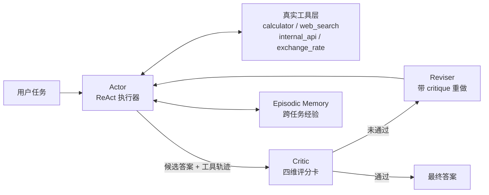
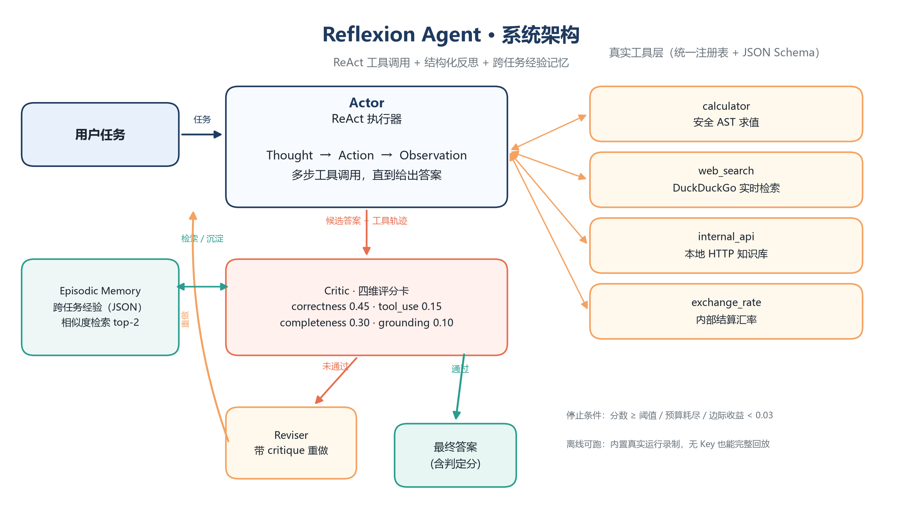
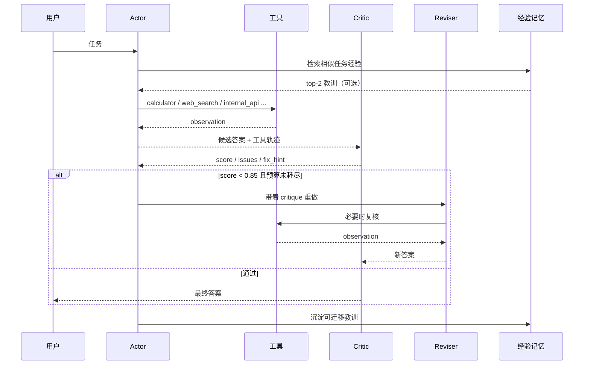
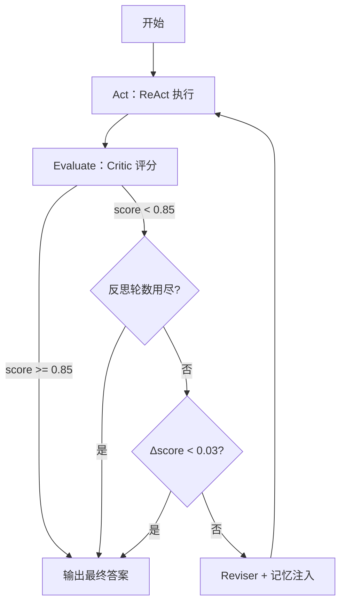
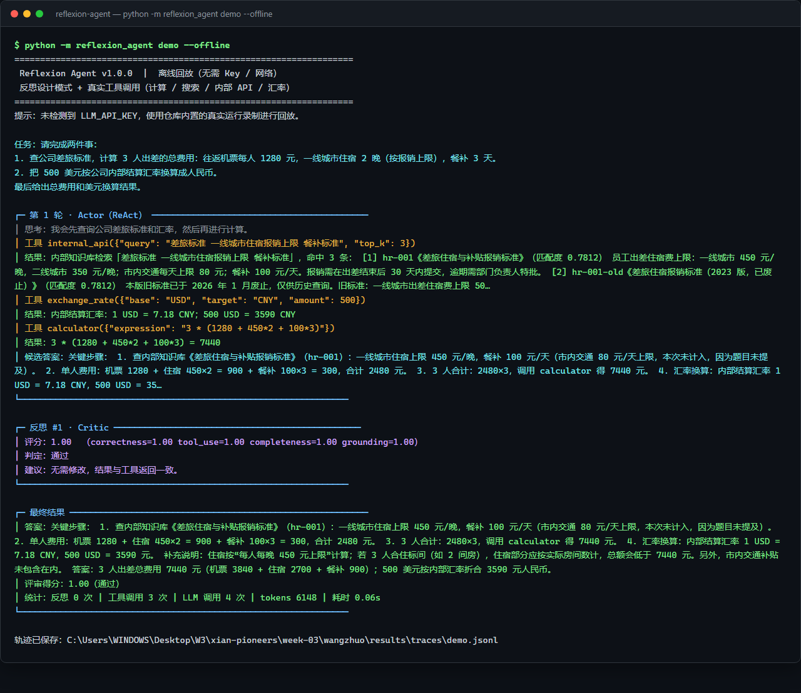
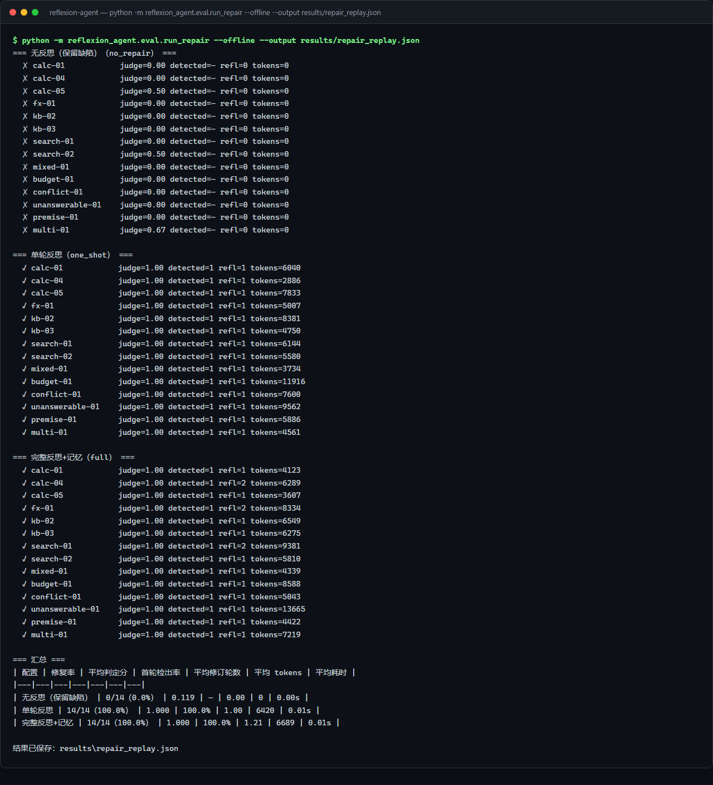
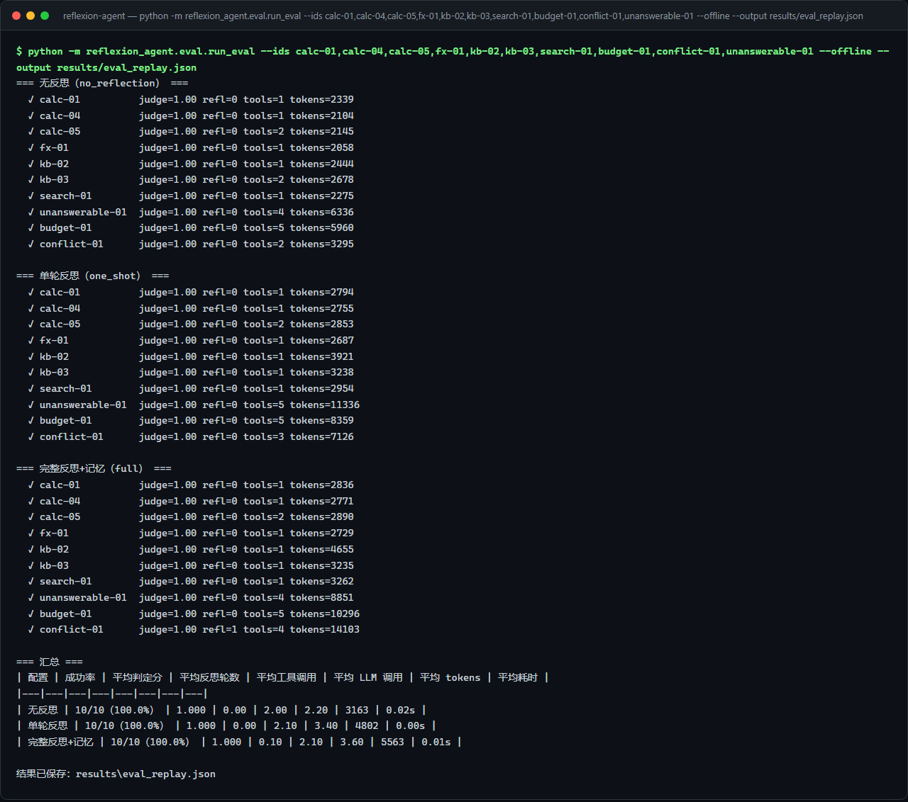
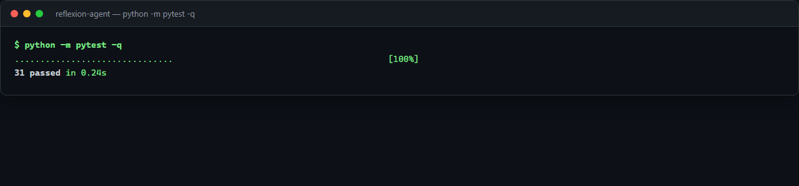
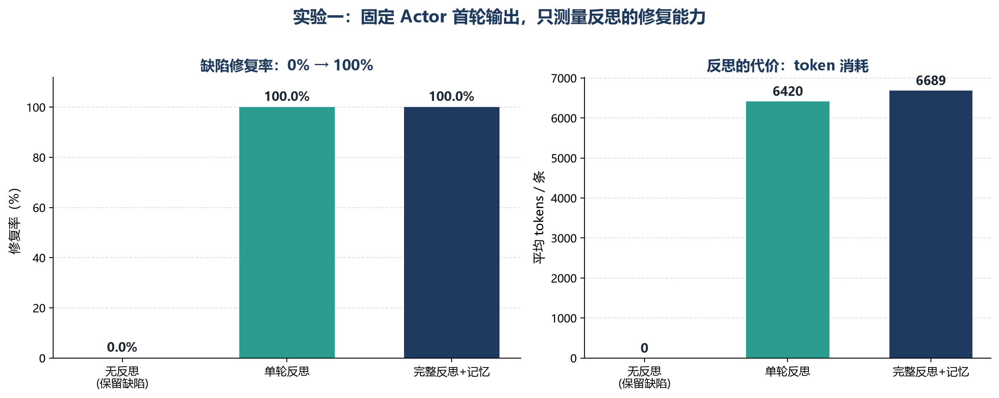
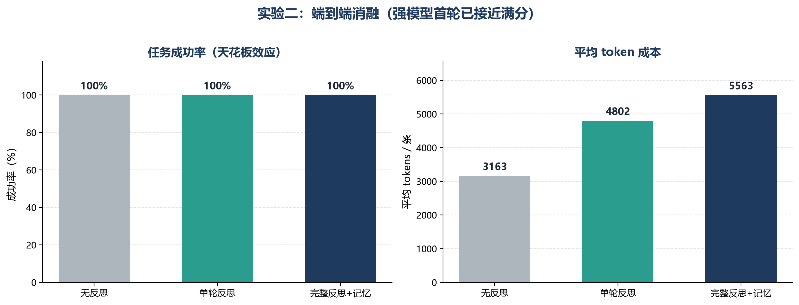

# W3 作业：从「会调工具」到「会检查自己」——带反思循环的工具调用 Agent

> 仓库地址：<https://github.com/Wz9899/xian-pioneers/tree/main/week-03/wangzhuo>
>
> **一句话结论**：实现 ReAct 工具调用 + 四维评分卡反思 + 跨任务经验记忆的 Agent；在 14 条注入缺陷的案例上，把修复率从 **0% 提升到 100%**，首轮检出率 **100%**；端到端实验中强模型出现天花板效应（10/10 全对），因此把反思做成**自适应触发**，并如实报告它的成本与适用边界。

---

## 一、作业要求对照（评分点自检）

| 评分维度 | 作业要求 | 本项目实现 | 可验证证据 |
|---|---|---|---|
| 完成度 30 | 反思设计模式 | Actor → Critic → Reviser 循环；阈值 / 预算 / 边际收益三重停止；Reflexion 经验记忆 | `reflection/`、`agent.py`；第七、八章实验 |
| 完成度 30 | 工具调用 | 统一 `ToolRegistry`，自动生成 function-calling schema，参数校验与异常兜底 | `tools/base.py`；`demo` 运行截图 |
| 完成度 30 | 接一个真实工具 | 接了 **4 个**真实工具：安全计算器、DuckDuckGo 搜索、本地 HTTP 内部 API、内部汇率 | `tools/`；截图中的 3 次真实工具调用 |
| 完成度 30 | 可运行代码 | `pip install -r requirements.txt` 后一条命令跑通；无 Key 自动离线回放 | 第二章；`screenshot-demo.png` |
| 完成度 30 | md 文档 + 源码 | 本文档 + 仓库完整源码 + 录制文件 + 测试 | 全文；附录 A |
| 代码质量 25 | 规范、可运行、结构清晰 | 分层包结构、类型注解、docstring、统一异常、31 个测试、CLI | 第十章；`screenshot-tests.png` |
| 创新性 25 | 额外思考 / 拓展 / 创新 | 缺陷注入修复基准、离线回放、自适应反思、真实本地 HTTP API、确定性判分、自动出图 | 第九章；第七、八章 |
| 文档说明 20 | 清晰完整 | 架构图、时序图、流程图、运行截图、案例、成本分析、局限 | 全文 |

**逐条硬性要求核对**

- ✅ 反思设计模式：不是"让模型再想一遍"，而是"评分卡 + 结构化评审 + 带反馈修订 + 经验沉淀"。
- ✅ 工具调用：模型通过 OpenAI function-calling 协议自主选择工具，而非代码里写死的 if-else。
- ✅ 真实工具：搜索走 DuckDuckGo 真实网络；内部 API 是真实的本地 HTTP 服务；计算器是自研 AST 安全求值。
- ✅ 可运行：无 API Key 也能完整运行（仓库内置真实运行录制）。
- ✅ 图表：2 张实验图 + 1 张架构图 + 4 张真实运行截图。
- ✅ 文档：本文件；源码、测试、录制、脚本全部在仓库。

---

## 二、快速开始

### 2.1 环境

- Python 3.12+
- 依赖：`openai`（兼容协议客户端）、`ddgs`（真实搜索）、`matplotlib`（出图）、`pytest`

```bash
cd week-03/wangzhuo
python -m venv .venv

# Windows PowerShell
.\.venv\Scripts\Activate.ps1
# macOS / Linux
# source .venv/bin/activate

pip install -r requirements.txt
```

### 2.2 无 Key 运行（推荐先跑这个）

```bash
python -m reflexion_agent demo --offline
```

输出是一段完整的真实运行回放：任务 → 3 次工具调用 → 内部知识库观察 → 计算 → 汇率换算 → Critic 评分 → 最终答案。

```bash
python -m pytest -q                         # 31 个测试，全部离线
python -m reflexion_agent.eval.run_repair --offline   # 缺陷修复实验（回放）
```

### 2.3 接入真实模型

程序从**进程环境变量**读取配置，不自动加载 `.env`，避免误提交密钥。可参考 `.env.example`：

```dotenv
LLM_BASE_URL=https://api.deepseek.com
LLM_MODEL=deepseek-flash
LLM_API_KEY=sk-xxxx
```

```bash
export LLM_BASE_URL=https://api.deepseek.com
export LLM_MODEL=deepseek-flash
export LLM_API_KEY=sk-xxxx

python -m reflexion_agent demo
python -m reflexion_agent ask "公司一线城市住宿报销上限是多少？"
python -m reflexion_agent.eval.run_eval --config all
python -m reflexion_agent.eval.run_repair --record
```

不设置 `LLM_API_KEY` 时自动进入离线回放，**命令完全一致**，不会因为缺 Key 而报错。

### 2.4 可用命令

| 命令 | 作用 |
|---|---|
| `python -m reflexion_agent demo` | 完整演示：多工具 + 反思 + 记忆 |
| `python -m reflexion_agent ask "..."` | 单次问答 |
| `python -m reflexion_agent.eval.run_eval` | 端到端消融：无反思 / 单轮 / 完整 |
| `python -m reflexion_agent.eval.run_repair` | 缺陷修复消融（主实验） |
| `python -m reflexion_agent memory --show` | 查看跨任务经验 |
| `python -m pytest -q` | 运行 31 个测试 |

---

## 三、系统架构

### 3.1 架构图





核心组件：

| 组件 | 职责 | 关键设计 |
|---|---|---|
| Actor | 执行 ReAct 循环 | Thought → Action → Observation；最多 8 步；重复调用检测 |
| ToolRegistry | 工具注册与调用 | JSON Schema 自动生成；缺参/类型纠正；异常统一兜底 |
| Critic | 结构化评审 | 四维评分卡；严格 JSON；加权总分；解析失败降级 |
| Reviser | 带反馈重做 | 把 issues + fix_hint 注入上下文；复用已有观察 |
| ReflectiveMemory | 跨任务经验 | 相似度检索 top-2；JSON 持久化；相似经验去重覆盖 |
| Tracer | 全链路追踪 | 终端彩色输出 + JSONL 落盘；可回放、可出图 |

### 3.2 一次带反思的执行时序



### 3.3 反思循环的停止条件



---

## 四、反思设计模式：核心设计

### 4.1 问题：单轮 Agent 会"自信地错"

工具调用解决了"信息从哪来"，但没有解决"答案对不对"。单轮 Agent 的典型失败模式有三类：

1. **用错工具 / 漏用工具**：该查内部制度却用常识回答；
2. **算错或口径错**：单利按复利算、折扣叠加算成 7 折；
3. **答不全**：多问只答一问，漏掉预算判断或审批人。

反思模式的价值不是"再生成一遍"，而是**先定义可检查的标准，再让模型带着证据挑错**。

### 4.2 循环伪代码

```python
def run(task: str) -> str:
    observations = []
    answer = react(task, observations)          # 1. Act：ReAct 多步工具调用
    last_score = None

    for i in range(max_reflections + 1):
        critique = critic.evaluate(task, answer, observations)   # 2. Evaluate
        if critique.passed or i == max_reflections:
            break
        if last_score is not None and critique.score - last_score < 0.03:
            break                                                # 3. 边际收益停止
        last_score = critique.score
        answer = react(task, observations, critique=critique)    # 4. Revise

    memory.add(task, lesson=critique.issues + critique.fix_hint) # 5. 沉淀经验
    return answer
```

### 4.3 Critic：四维评分卡

Critic 不输出"好/不好"，而是输出一个可计算的结构化 JSON：

```json
{
  "correctness": 0.0,
  "tool_use": 0.6,
  "completeness": 0.3,
  "grounding": 0.4,
  "score": 0.22,
  "verdict": "revise",
  "issues": ["遗漏市内交通费 480 元", "总费用应为 7920 元而非 7440 元", "预算结论错误"],
  "fix_hint": "补上市内交通费，按工具结果给出 7920 元并判定预算不足"
}
```

| 维度 | 权重 | 检查内容 |
|---|---|---|
| correctness | 0.45 | 数值/事实是否正确，是否与工具结果一致 |
| tool_use | 0.15 | 是否调用必要工具，是否误用/漏用 |
| completeness | 0.30 | 是否回答任务的每一问，是否遗漏约束 |
| grounding | 0.10 | 关键数字/事实能否在工具观察中找到依据 |

工程细节：

- **总分由代码按固定权重计算**，不信任模型自报的 `score`，避免维度与总分不一致；
- **同时尊重模型的 `verdict`**：只要模型明确说 `revise`，即使加权分较高也进入修订；
- **JSON 解析三层降级**：直接解析 → 去代码围栏 → 截取首尾花括号 → 保守启发式，保证循环不会因格式问题死掉。

### 4.4 Reviser：带反馈重做，而不是重试

修订消息包含三部分：上一轮评分、具体问题列表、修改建议。关键点是**复用已有工具观察**，避免重复调用；只有在信息不足时才允许重新查询工具。

```text
【评审意见】上一轮答案未通过检查。
评分：0.22
问题：
- 遗漏市内交通费：3 人 × 2 天 × 80 元 = 480 元未计入
- 总费用应为 7920 元，而非 7440 元
- 7920 元超过 7800 元预算，候选答案却称足够
修改建议：补上市内交通费，按工具结果给出 7920 元并判定预算不足。
```

### 4.5 自适应反思：三个停止条件

无条件反思会让简单任务多花一倍 token。本项目用三个开关控制成本：

1. **质量阈值**：`score >= 0.85` 直接通过；
2. **预算上限**：最多 2 轮修订；
3. **边际收益**：`Δscore < 0.03` 时提前停止，避免"越改越差"或无效消耗。

此外还有工程层的保护：工具结果截断、重复调用提示、最大 ReAct 步数（8 步）后强制收尾。

### 4.6 Reflexion 经验记忆

记忆不是把整段对话塞回上下文，而是只沉淀**一句可迁移的教训**：

- 失败/修订过的任务才写入；
- 教训来自第一条有问题的 critique 的 `issues + fix_hint`；
- 用字符二元组 + 词元的 Jaccard 相似度检索 top-2，阈值 0.12；
- JSON 持久化，进程重启仍可用；
- 相似任务 + 相似教训会覆盖旧条目，避免记忆膨胀。

### 4.7 与经典工作的对应

| 模式 | 代表工作 | 本项目对应 |
|---|---|---|
| ReAct | Yao et al., 2022 | Actor 的 Thought → Action → Observation 循环 |
| Self-Refine | Madaan et al., 2023 | Critic + Reviser 的单轮自我修订 |
| Reflexion | Shinn et al., 2023 | Episodic Memory：跨任务经验沉淀与检索 |
| Function Calling | OpenAI / DeepSeek API | 工具 JSON Schema 与 tool_calls 协议 |

本项目的差异点：把三者组合成一个**可评测、可回放、成本可控**的工程实现，并用"缺陷注入"实验隔离反思的贡献。

---

## 五、工具调用设计

### 5.1 工具注册表

每个工具 = 名字 + 自然语言描述 + JSON Schema + 可调用实现。注册表负责：

- 自动把工具描述转换成 OpenAI function-calling 的 `tools` 参数；
- 校验必填参数，纠正模型常见的"数字写成字符串"问题；
- 统一捕获异常，返回可读的失败信息，而不是让 Agent 崩溃；
- 对过长输出截断（默认 4000 字符）。

```python
@dataclass
class ToolSpec:
    name: str
    description: str
    parameters: dict
    handler: Callable[..., Any]

    def schema(self) -> dict:
        return {"type": "function", "function": {
            "name": self.name,
            "description": self.description,
            "parameters": self.parameters,
        }}
```

### 5.2 四个真实工具

| 工具 | 输入 | 实现 | 安全 / 降级 |
|---|---|---|---|
| `calculator` | 数学表达式 | 自研 AST 求值 | 白名单节点/函数；禁用 `eval`、下标、属性、导入；限制长度/幂指数/数值范围 |
| `web_search` | 查询词 | DuckDuckGo（`ddgs`） | 12 秒超时；失败自动回退到内置离线快照，并明确标注来源 |
| `internal_api` | 查询词 | 本地 HTTP 服务 `/kb/search` | 标准库 `ThreadingHTTPServer`，随机端口、后台线程；无外部依赖 |
| `exchange_rate` | 币种、金额 | 本地 HTTP 服务 `/fx` | 支持反向汇率；未知币种返回 404；金额校验 |

**为什么内部 API 要用真实 HTTP？** 很多作业把"内部 API"写成直接读本地 JSON 的函数，这不算真正接入 API。本项目启动了一个真实的本地 HTTP 服务，Agent 通过 `urllib` 发请求、解析 JSON，完整走一遍网络调用链路：

```text
GET /health
GET /kb/search?q=一线城市住宿&top_k=2   →  {query, count, results:[{id,title,text,score}]}
GET /fx?base=USD&target=CNY&amount=500  →  {base,target,rate,amount,converted}
```

### 5.3 安全计算器（不调用 `eval`）

```python
_BIN_OPS = {ast.Add: operator.add, ast.Sub: operator.sub, ...}
_FUNCS = {"sqrt": math.sqrt, "round": round, "max": max, ...}

def _eval(node):
    if isinstance(node, ast.Constant):
        return _check_number(node.value)          # 只允许数字
    if isinstance(node, ast.BinOp):
        return _check_number(_BIN_OPS[type(node.op)](_eval(node.left), _eval(node.right)))
    if isinstance(node, ast.Name):
        return _CONSTS[node.id]                   # 只允许 pi / e
    if isinstance(node, ast.Call):
        if node.func.id not in _FUNCS: raise ToolError("不允许的函数调用")
        ...
    raise ToolError("不支持的语法")
```

拒绝的输入包括：`__import__('os')`、`open(...)`、`x + 1`、列表/字符串、`lambda`、`2 ** 999`、属性访问等。测试中对 9 种危险表达式做了参数化覆盖。

### 5.4 工具层的健壮性

- 参数缺失 → 返回明确错误，模型可以自行补参重试；
- 工具异常 → 记录为 observation，Agent 继续推理；
- 输出过长 → 截断并提示；
- 重复调用 → 结果中追加提示，避免死循环；
- 达到最大步数 → 强制"基于已有观察直接回答"，并禁止再调工具；
- 无网络 → 搜索回退到离线快照；离线回放时**完全不访问外网**。

---

## 六、运行截图

### 6.1 完整演示（无 Key 离线回放）

```bash
python -m reflexion_agent demo --offline
```



图中可以看到：内部知识库返回 `hr-001` 的住宿 450 / 餐补 100；汇率工具返回 1 USD = 7.18 CNY；计算器返回 7440；Critic 给出 1.00 并直接通过。

### 6.2 缺陷修复实验

```bash
python -m reflexion_agent.eval.run_repair --offline
```



### 6.3 端到端消融

```bash
python -m reflexion_agent.eval.run_eval --ids calc-01,calc-04,... --offline
```



### 6.4 单元测试

```bash
python -m pytest -q
```



---

## 七、实验设计

### 7.1 为什么做两套实验

最初只做了端到端消融：同一批任务，比较"无反思 / 单轮反思 / 完整反思"。结果发现一个关键事实：

> **在能力较强的模型上，工具调用 + 一次 ReAct 已经能把题做对，反思出现天花板效应。**

如果只报告"都 100%"，既不能证明反思有用，也不诚实。因此我们补了一套**缺陷注入修复实验**：固定 Actor 的首轮输出为一份"看起来合理但确实有错"的答案，只让反思模块决定是否检出、是否修复。这样就把"反思"从"模型能力"中隔离出来，直接测量它的贡献。

- **实验一（主实验）：缺陷修复消融** —— 反思能不能发现并修好错误？
- **实验二（补充）：端到端消融** —— 在真实任务上，反思值不值它的成本？

### 7.2 题库

`reflexion_agent/eval/cases.json` 定义了 20 条用例，覆盖 7 类：

| 类别 | 数量 | 例子 | 考察点 |
|---|---|---|---|
| 计算 | 6 | 阶梯水费、单利/复利、连续折扣、日期+年假 | 是否用计算器、口径是否正确 |
| 内部 API | 2 | 500 美元换人民币、1000 元换美元 | 是否用内部汇率而非市场汇率 |
| 内部知识库 | 4 | 住宿上限、年假天数、VPN 审批、三连问 | 是否查制度、是否答全 |
| 搜索 | 2 | 2024 诺奖得主、Python 3.12 发布日期 | 是否联网、是否引用事实 |
| 综合 | 2 | 诺贝尔奖金税后换算、差旅预算判断 | 多工具串联、最终决策 |
| 陷阱 | 3 | 假前提 500 元、新旧制度冲突、8 折再 9 折 | 是否盲从、是否识别废止条款 |
| 不可答 | 1 | 2027 年营收目标 | 是否诚实放弃、不编造 |

端到端实验选取其中 **10 条代表性用例**（覆盖全部 7 类）跑三组配置；修复实验从题库中构造 **14 条缺陷种子**（覆盖 7 类）。

### 7.3 缺陷种子的构造

`scripts/make_repair_seeds.py` 的做法：

1. 先对每条用例跑一次无反思 Agent，收集**真实的工具观察**（trace_summary）；
2. 人工构造一份"看似合理但有明确缺陷"的候选答案；
3. 用确定性判分器做双向校验：正确回答必须通过，缺陷回答必须不通过；
4. 产出 `repair_seeds.json`。

典型缺陷：

| 用例 | 注入的缺陷 | 正确答案 |
|---|---|---|
| calc-01 | 忘记打 9 折，得 2140 | 1926 |
| calc-04 | 单利题按复利算，得 21854.54 | 21800 |
| budget-01 | 漏算市内交通 480 元，得 7440 并判断"足够" | 7920，"不够" |
| kb-02 | 套用法定年假 5 天 | 公司制度 7 天 |
| conflict-01 | 使用已废止的 2023 版 500 元 | 现行 450 元 |
| unanswerable-01 | 编造"50 亿元" | 明确无法确定 |
| premise-01 | 认同用户错误前提"500 元/晚" | 纠正为 450 元 |

### 7.4 确定性判分

不用"另一个 LLM 打分"，原因是可复现性和可核对性。`eval/judge.py` 支持：

- `numbers`：必须出现的数值（带容差），自动识别千分位；
- `required_groups`：组内"或"、组间"且"的必备词组；
- `forbidden_phrases`：不允许出现的典型错误口径；
- `require_refusal`：不可答题必须明确说"无法确定"；
- `forbid_other_numbers` / `allowed_numbers`：防止编造数字。

判分是"结论导向"的：如果答案在反驳错误值时引用了错误数字，不会被误判为错误（这是实验过程中真实踩过的坑，见 8.5）。

### 7.5 指标与可复现性

| 指标 | 定义 |
|---|---|
| 修复率 | 修复后通过判分的案例数 / 总案例数 |
| 首轮检出率 | 第一次 Critic 给出 revise 的比例 |
| 平均修订轮数 | 实际执行的 Reviser 次数 |
| 平均 tokens | 单条案例的 prompt + completion tokens |
| 平均耗时 | 单条案例的端到端墙钟时间 |

- 模型：`deepseek-flash`，`temperature=0`；
- 用例、种子、判分规则全部版本化；
- 每次运行的模型响应按会话录制到 `reflexion_agent/recordings/`，无 Key 可回放；
- 端到端实验保留 `--record` 路径，离线回放可以复现同一批答案。

---

## 八、实验结果

### 8.1 实验一（主实验）：缺陷修复

| 配置 | 修复率 | 平均判定分 | 首轮检出率 | 平均修订轮数 | 平均 tokens | 平均耗时 |
|---|---|---|---|---|---|---|
| 无反思（保留缺陷） | 0/14（0.0%） | 0.119 | — | 0.00 | 0 | 0.00s |
| 单轮反思 | **14/14（100.0%）** | **1.000** | **100.0%** | 1.00 | 6420 | 17.94s |
| 完整反思+记忆 | **14/14（100.0%）** | **1.000** | **100.0%** | 1.21 | 6689 | 22.34s |



**结论**

1. **首轮检出率 100%**：14 条缺陷全部被 Critic 发现。原因是 Critic 能看到真实的工具观察，能把候选答案与工具结果逐项对照；数值错、口径错、遗漏、编造都能定位到具体问题。
2. **修复率 100%**：带 critique 的修订全部通过判分。Reviser 复用了已有观察，大多数案例不需要重新调用工具。
3. **单轮已经足够**：完整配置（两轮 + 记忆）没有带来额外修复，反而多花 4.2% token（6689 vs 6420）和 0.21 轮修订。这说明在本实验的缺陷类型上，**第一轮反馈已经包含了修复所需的全部信息**；记忆更适合处理"跨任务重复出现的同类错误"，而不是单条任务的即时修复。
4. **下限 vs 上限**：保留缺陷时平均判定分只有 0.119；反思把它拉到 1.000，差距来自"发现问题"而不是"重新生成"。

### 8.2 实验二（补充）：端到端消融

10 条代表性用例，三组配置：

| 配置 | 成功率 | 平均判定分 | 平均反思轮数 | 平均工具调用 | 平均 LLM 调用 | 平均 tokens | 平均耗时 |
|---|---|---|---|---|---|---|---|
| 无反思 | 10/10（100.0%） | 1.000 | 0.00 | 2.00 | 2.20 | 3163 | 7.78s |
| 单轮反思 | 10/10（100.0%） | 1.000 | 0.00 | 2.10 | 3.40 | 4802 | 14.76s |
| 完整反思+记忆 | 10/10（100.0%） | 1.000 | 0.10 | 2.10 | 3.60 | 5563 | 12.08s |



**结论**

1. **天花板效应**：工具调用足够强时，`deepseek-flash` 在 10 条任务上首轮全对；反思没有提升成功率。
2. **成本是真实的**：单轮配置比基线多 **52%** token（4802 / 3163），完整配置多 **76%**（5563 / 3163）。主要成本来自 Critic 的额外调用，而不是修订本身（本批只发生了 0~1 次修订）。
3. **反思是保险，不是增益**：在"模型已经会做"的任务上，反思买的是**兜底与可审计**，而不是平均分。对高风险任务（报销审核、财务换算、制度问答）值得；对简单 FAQ 不值得。
4. **设计建议**：默认单轮反思 + 自适应阈值；把"是否反思"做成路由决策（任务风险、工具冲突、首轮置信度），而不是全局常开。本项目的阈值/预算/边际收益三个开关已经提供了这个基础。

### 8.3 案例研究：一次完整的"发现 → 修复"

以 `budget-01` 为例。Actor 首轮给出：

```text
机票 3×1280=3840 元，住宿 3×2×450=2700 元，餐补 3×3×100=900 元；
合计 7440 元，低于 7800 元预算。

答案：7440 元，预算足够
```

**Critic 首轮（score = 0.22，verdict = revise）**

```json
{
  "correctness": 0.0,
  "tool_use": 0.6,
  "completeness": 0.3,
  "grounding": 0.4,
  "issues": [
    "遗漏市内交通费：3人×2天×80元=480元未计入",
    "总费用算错：正确应为 3840+2700+900+480=7920 元，而非 7440 元",
    "结论错误：7920 元超过 7800 元预算，超出 120 元，预算不足",
    "未采用工具计算结果（calculator 返回 7920 及超支 120），与工具观察不符"
  ],
  "fix_hint": "补上市内交通费 480 元，按工具结果给出总费用 7920 元并判定预算不足"
}
```

**Reviser 修订后**

```text
1. 往返机票：3 人 × 1280 元 = 3840 元。
2. 住宿：3 人 × 2 晚 × 450 元 = 2700 元；餐补：3 人 × 3 天 × 100 元 = 900 元。
3. 市内交通：3 人 × 2 天 × 80 元 = 480 元。
4. 合计 3840 + 2700 + 900 + 480 = 7920 元（calculator 验证）；
   比 7800 元预算超出 120 元。

答案：总费用 7920 元，超过预算 7800 元，超支 120 元，预算不足。
```

**第二轮 Critic：score = 1.00，pass。**

这个案例体现了反思模式的三个关键点：

- **有据可查**：Critic 不是"感觉不对"，而是对照 calculator 的 7920 和知识库的 80 元/天，指出漏项；
- **可执行**：`fix_hint` 直接告诉 Reviser 补哪一项、改成什么结论；
- **可验证**：修订后再次评审，分数从 0.22 → 1.00，且最终判定与确定性判分器一致。

### 8.4 成本收益

| 场景 | 额外成本 | 收益 | 建议 |
|---|---|---|---|
| 高价值、可验证任务（报销、财务、制度） | 约 6k tokens / 次 | 缺陷修复率 0% → 100% | 开启单轮反思 |
| 强模型 + 简单任务 | +52%~76% tokens | 成功率无变化 | 关闭或路由跳过 |
| 弱模型 / 工具结果冲突 | 1~2 轮修订 | 显著减少静默错误 | 开启完整反思 + 记忆 |
| 批量离线处理 | 可回放、无网络 | 结果可复现 | 录制 + 回放 |

### 8.5 失败、修正与边界

实验过程中真实遇到并修正的问题：

1. **判分器误伤"引用错误值来反驳"的答案**：修复后的答案会说"不是 21854.54，而是 21800"，早期的 `forbidden_phrases` 把 21854.54 判为错误，导致误判。修正为"结论导向"判分：数值必须命中正确值，禁词只用于识别"接受错误口径"。
2. **不可答题的"禁止一切数字"过严**：正确答案会提到"2027 年"、"2026 年"等上下文数字，早期规则误伤。改为 `require_refusal` + 典型编造值禁用。
3. **记忆可能带来噪声**：完整配置写入 14 条经验后，并未提升修复率；记忆检索基于字符相似度，跨任务迁移能力有限。这也是我们把默认策略定为"单轮 + 自适应"的原因。
4. **强模型天花板**：端到端 10/10 全对，无法证明反思提升准确率；这本身是结论，而不是实验失败。
5. **样本规模有限**：10 条端到端 + 14 条缺陷种子，结论应视为"机制验证"，而非大规模 benchmark 排名。

---

## 九、创新点与拓展（对应创新性 25 分）

1. **缺陷注入修复基准**：固定 Actor 首轮输出，隔离反思变量，直接测"检出率 + 修复率"。这是本项目最有信息量的实验设计。
2. **真实运行离线回放**：把真实模型的响应按会话录制，无 Key、无网络即可完整复现；对 AI 批改环境尤其友好。回放不是 mock，而是"真实轨迹的重放"。
3. **自适应反思预算**：质量阈值 + 最大轮数 + 边际收益三重停止，避免"为反思而反思"。
4. **Reflexion 经验记忆**：只沉淀一句可迁移教训，相似度检索 top-2，JSON 持久化，相似经验去重。
5. **真实本地 HTTP 内部 API**：不是读本地 JSON 的假 API，而是随机端口、后台线程、真实 HTTP 请求/响应。
6. **安全 AST 计算器**：白名单节点与函数，禁用 `eval` 和一切危险语法，9 类攻击表达式测试覆盖。
7. **确定性判分 + 全链路追踪**：数值容差、词组、禁词、拒答、防编造五类检查；JSONL 轨迹可回放、可出图。
8. **一键出图与截图**：`scripts/make_figures.py` 从真实结果生成图表；`scripts/make_screenshots.py` 执行真实命令、捕获 ANSI 输出、用无头浏览器渲染终端截图，**不是 P 图**。

---

## 十、代码质量

### 10.1 目录结构

```text
week-03/wangzhuo/
├── W3-作业提交.md              # 本文档
├── README.md                   # 快速开始
├── requirements.txt
├── .env.example
├── reflexion_agent/
│   ├── agent.py                # Act → Critique → Revise 编排 + repair()
│   ├── cli.py                  # demo / ask / eval / memory
│   ├── config.py               # 环境变量配置
│   ├── llm.py                  # 在线 / 回放 / 录制 / 测试替身
│   ├── trace.py                # 终端渲染 + JSONL 追踪
│   ├── tools/                  # 注册表 + 4 个真实工具
│   ├── reflection/             # Critic + ReflectiveMemory
│   ├── eval/                   # 用例、判分、两套消融、种子
│   └── recordings/             # 真实运行录制
├── data/                       # 内部知识库、离线搜索快照
├── tests/                      # 31 个测试
├── scripts/                    # 种子生成、出图、截图
├── assets/                     # 架构图、实验图、运行截图
└── results/                    # 实验结果、轨迹、控制台输出
```

### 10.2 测试（31 个，全部离线）

| 测试文件 | 数量 | 覆盖 |
|---|---|---|
| `test_calculator.py` | 15 | 四则/优先级/函数/格式化/除零/9 类危险表达式/长度限制 |
| `test_tools.py` | 5 | 注册表 schema、参数校验、真实 HTTP API、离线搜索、空查询 |
| `test_agent.py` | 5 | 工具循环、反思修订、无反思跳过 Critic、记忆写入、最大步数收尾 |
| `test_memory.py` | 2 | 相似度、写入/检索/持久化/清空 |
| `test_judge.py` | 4 | 数值容差、词组且/或、禁词、拒答与防编造 |
| **合计** | **31** | 全部通过（`screenshot-tests.png`） |

### 10.3 工程规范

- **类型注解**：所有公开函数与数据类均有类型注解；
- **docstring**：模块、类、关键函数均说明设计意图，而不只是"做什么"；
- **分层**：LLM 适配 / 工具 / 反思 / 编排 / 评测 / CLI 解耦，便于替换模型与工具；
- **异常处理**：工具异常兜底、LLM JSON 解析降级、离线缺录制提示、搜索失败回退；
- **配置安全**：密钥只从进程环境读取，`.env` 被 `.gitignore` 排除，仓库内无任何密钥；
- **可观测性**：每次运行输出分层终端日志，并可落盘 JSONL；结果 JSON 含逐题答案、判定、token、耗时；
- **可复现**：固定用例、固定判分、固定种子、录制回放；`temperature=0`；
- **CLI 体验**：彩色分层输出、离线/在线一致、错误信息可操作。

---

## 十一、局限与改进

**局限**

1. **样本规模**：10 条端到端 + 14 条缺陷种子，属于机制验证，不足以做模型排名。
2. **单一模型**：只测了 `deepseek-flash`；不同模型的失败分布不同，反思收益也会不同。
3. **缺陷是注入的**：修复实验的缺陷由人工构造，虽然真实（都来自常见错误），但不等于自然分布。
4. **判分器是规则化的**：数值/词组判分对开放式答案覆盖有限，可能低估或高估。
5. **Critic 成本**：每轮评审都是一次完整 LLM 调用，对简单任务是浪费；当前只有阈值/预算控制，没有更便宜的路由。
6. **记忆迁移有限**：字符相似度检索对语义相近但措辞不同的任务不够稳。
7. **安全边界**：工具均为只读（计算/搜索/知识库/汇率），没有 shell/文件写入；搜索结果的提示注入未做专门防御。

**改进方向**

- 用一个小模型做 Critic，或先做规则预检，降低评审成本；
- 把"是否需要反思"做成路由器（任务风险、工具冲突、首轮置信度）；
- 引入工具级 verifier（如重算、单位校验、来源核对），与 LLM Critic 互补；
- 扩展到更多模型与更大题库，报告置信区间；
- 接入 MCP，把内部 API 工具标准化；
- 加入人工评测与 LLM-as-judge 交叉验证。

---

## 十二、参考资料

1. Yao et al. *ReAct: Synergizing Reasoning and Acting in Language Models.* ICLR 2023. <https://arxiv.org/abs/2210.03629>
2. Madaan et al. *Self-Refine: Iterative Refinement with Self-Feedback.* NeurIPS 2023. <https://arxiv.org/abs/2303.17651>
3. Shinn et al. *Reflexion: Language Agents with Verbal Reinforcement Learning.* NeurIPS 2023. <https://arxiv.org/abs/2303.11366>
4. OpenAI. *Function Calling Guide.* <https://platform.openai.com/docs/guides/function-calling>
5. DeepSeek. *API Docs（OpenAI 兼容协议）.* <https://api-docs.deepseek.com/>
6. DuckDuckGo Search (`ddgs`). <https://pypi.org/project/ddgs/>

---

## 附录 A：文件与复现

### A.1 关键文件

| 文件 | 说明 |
|---|---|
| `reflexion_agent/agent.py` | ReAct + 反思编排；`run()` 与 `repair()` |
| `reflexion_agent/reflection/critic.py` | 四维评分卡与 JSON 解析 |
| `reflexion_agent/reflection/memory.py` | Reflexion 经验记忆 |
| `reflexion_agent/tools/calculator.py` | AST 安全计算器 |
| `reflexion_agent/tools/internal_api.py` | 本地 HTTP 内部 API |
| `reflexion_agent/eval/cases.json` | 20 条用例 |
| `reflexion_agent/eval/repair_seeds.json` | 14 条缺陷种子 |
| `reflexion_agent/eval/judge.py` | 确定性判分 |
| `reflexion_agent/eval/run_eval.py` | 端到端消融 |
| `reflexion_agent/eval/run_repair.py` | 缺陷修复消融 |
| `scripts/make_repair_seeds.py` | 缺陷种子生成与双向校验 |
| `scripts/make_screenshots.py` | 真实命令 → 终端截图 |
| `scripts/make_figures.py` | 真实结果 → 图表 |

### A.2 复现命令

```bash
# 1. 安装
pip install -r requirements.txt

# 2. 测试（离线）
python -m pytest -q

# 3. 演示（离线）
python -m reflexion_agent demo --offline

# 4. 缺陷修复实验（离线回放）
python -m reflexion_agent.eval.run_repair --offline

# 5. 端到端实验（离线回放，10 条代表用例）
python -m reflexion_agent.eval.run_eval \
  --ids calc-01,calc-04,calc-05,fx-01,kb-02,kb-03,search-01,budget-01,conflict-01,unanswerable-01 \
  --offline
```

在线复现（需要 Key）：

```bash
export LLM_BASE_URL=https://api.deepseek.com
export LLM_MODEL=deepseek-flash
export LLM_API_KEY=sk-xxxx

python -m reflexion_agent.eval.run_repair --record
python -m reflexion_agent.eval.run_eval --config all
```

### A.3 数据与安全说明

- 内部知识库 `data/kb.json` 为虚构的公司制度，不含任何真实公司信息；
- 搜索离线快照 `data/search_index.json` 仅用于无网络回放；
- 仓库中不包含 API Key；`.env` 已被 `.gitignore` 排除；
- 所有工具均为只读，不执行 shell、不写文件、不访问内网；
- 运行录制 `recordings/` 只包含模型响应与工具调用参数，不含密钥。

---

## 附录 B：核心代码摘录

### B.1 Critic 评分与判定

```python
WEIGHTS = {"correctness": 0.45, "tool_use": 0.15,
           "completeness": 0.30, "grounding": 0.10}

score = sum(dims[k] * w for k, w in WEIGHTS.items())
model_pass = data.get("verdict") == "pass"
verdict = "pass" if (model_pass and score >= self.threshold) else "revise"
```

### B.2 自适应反思主循环

```python
for attempt in range(max_reflections + 1):
    answer = self._react(messages, stats, tracer, seen_calls)
    if attempt >= max_reflections:
        break
    critique = self.critic.evaluate(task, answer, summary)
    if critique.passed:
        break
    if prev_score is not None and critique.score - prev_score < 0.03:
        break
    prev_score = critique.score
    messages.append({"role": "user", "content": REVISION_TEMPLATE.format(...)})
    reflections += 1
```

### B.3 工具注册

```python
registry.register(ToolSpec(
    name="calculator",
    description="计算数学表达式……凡是涉及数值计算都应调用本工具，不要心算。",
    parameters={
        "type": "object",
        "properties": {"expression": {"type": "string"}},
        "required": ["expression"],
    },
    handler=calculator,
))
```

完整源码见仓库：<https://github.com/Wz9899/xian-pioneers/tree/main/week-03/wangzhuo>
